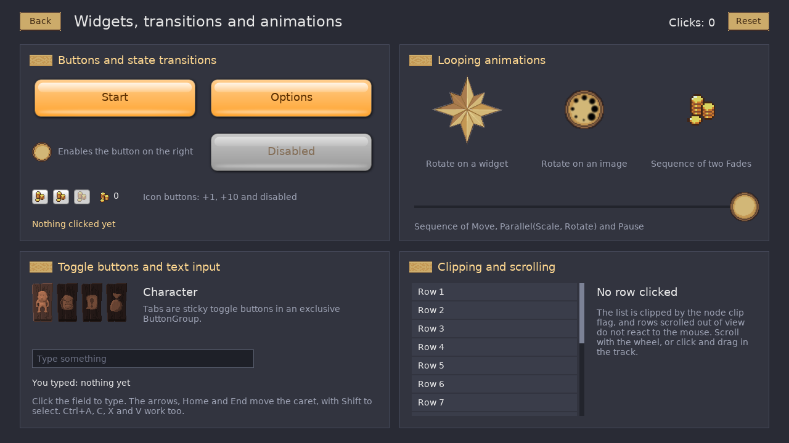

# Luif - Lua UI Framework

Luif is a retained UI framework in plain Lua: a tree of items with layouts,
skins, states, transitions and animations. It draws through a small retained
host interface, so a host renders frames on its own and Lua only runs when
something changes. A host for LOVE 11.5 is included.

[](doc/screenshots/demo.webm)

## Features

* One item class for everything in the tree, with position, size,
  rotation, scale, opacity, clipping and input.
* Content items: `Image`, `Label`, `Rectangle`, nine-slices (`Scale9`,
  `ScaleH3`, `ScaleV3`), `SlicedImage` and `Line`.
* Controls: `Button`, `ToggleButton` and `ButtonGroup`, `LineEdit`,
  `TextArea`, `Slider`, `ScrollArea`, `HorizontalScrollbar`, `ProgressBar`,
  `List`, `PannableView`, `Window` and tooltips.
* Layouts: anchors, rows, columns, grids and paths.
* States with transitions, and effects such as `Animate`, `Move`, `Rotate`,
  `Fade`, `Sequence` and `Parallel`.
* Skins as ordinary child items, so a control's look is replaceable.
* Input: picking that follows transforms and clips, event bubbling, pointer
  capture, double clicks, keyboard focus and fallback listeners.
* A UI scale applied in one place, text substitution with plural forms and
  colour tags, and a string table for translations.

## Getting started with LOVE

Copy the `luif` folder next to your `main.lua`:

```lua
local luif = require "luif"

luif.root:addChild(luif.Button {
    text = "Hello",
    horizontalCenter = 0, verticalCenter = 0,
    click = function() print("clicked") end,
})

luif.hook()
```

`luif.hook()` runs Luif from the LOVE callbacks, after your own. To call it
yourself instead, use `luif.update(dt)` and `luif.draw()` and forward the
input callbacks, such as `luif.mousepressed(x, y, button)`; they return true
when the UI handled the input.

`example/` is a larger application with screens, dialogs, skins and
animations. Run it from the repository root with `love example`.

## Repository

| directory | contents |
|---|---|
| `luif/core/` | the framework, portable Lua without LOVE or other platform dependencies |
| `luif/host/` | the retained host interface and a recording host for tests |
| `luif/love/` | the LOVE host and the glue that runs an application on LOVE |
| `example/` | the example application |
| `tests/` | tests for LOVE (`love tests`) and plain LuaJIT (`luajit tests/run_luajit.lua`) |
| `tools/` | static checks (`tools/check-globals.sh`) |
| `doc/` | documentation |

## Documentation

* [`doc/love.md`](doc/love.md): running the example and the tests,
  portability and known gaps.
* [`doc/architecture.md`](doc/architecture.md): the host interface, items and
  nodes, skins and the event contract.

## License

The framework is available under the MIT license, see [`LICENSE`](LICENSE).

`luif/core/beziereasing.lua` is based on
[bezier-easing](https://github.com/gre/bezier-easing) by Gaëtan Renaudeau,
also under the MIT license.

The artwork in `example/images` comes from the
[Source of Tales](https://gitlab.com/tales/tales-client) client and is
available under CC0, CC-BY-SA 3.0 or GPLv3, as listed in that project's
`AUTHORS` file.
