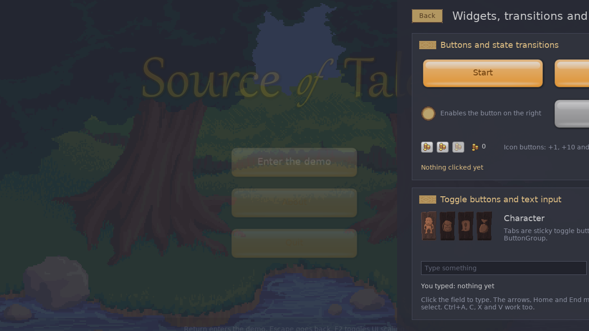
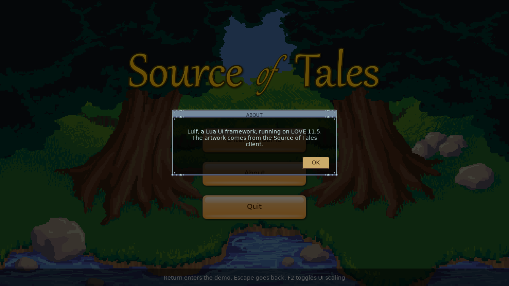

# Luif on LOVE

The framework under `luif/core/` is plain Lua and draws through the retained host
interface (see `doc/architecture.md`). `luif/love/` implements that interface on
LOVE 11.5, and `example/` is a small application built on it.

## How to run

From the repository root:

* `love example` starts the example (`example/` is the LOVE source directory;
  its `main.lua` puts the repository root on `package.path`).
* `love tests` runs every `tests/test_*.lua` and exits with status 0 when all
  checks pass.
* `luajit tests/run_luajit.lua` runs the same test files without LOVE, with a
  recording host as core's host that reads files and PNG sizes from disk;
  tests of LOVE only code (drawing, the love callbacks, LOVE font metrics)
  report skips.
* `tools/check-globals.sh` runs the static checks on `luif/core/` (portability,
  node use, the UI scale) and checks that `luif/host/` uses no `love`, `io` or
  `os`.

## The example

Keys: Return enters the demo, Escape goes back to the title screen or, on the
title screen, asks to quit, and F2 toggles between 1:1 pixels (the default)
and the adaptive UI scale (`Screen:setAdaptive(true)`, which fits a
virtual screen of `Screen.adaptiveWidth` by `adaptiveHeight` into the
window). The keys are handled by a bottom fallback listener, so an open
dialog or a focused text field gets them first.

Environment variables for headless runs:

* `LUIF_SCREENSHOT=name` writes `name.png` to the LOVE save directory after
  1.5 seconds and quits (the path is printed).
* `LUIF_SCENE=demo,dialog` chooses what is on screen: `demo` starts on the
  demo screen, `dialog` opens a dialog, `transition` starts the page switch
  just before the capture, `scaled` resizes the window to 1000x600 and
  toggles the adaptive UI scale like F2, and `tooltip` hovers Start so its
  tooltip is in the capture. With `LUIF_SELFTEST=1`, `scaled` runs the
  self-test at that scale.
* `LUIF_SMOKE=1` quits with status 0 after two seconds.
* `LUIF_SELFTEST=1` runs `example/selftest.lua`, which clicks through both
  screens and the dialogs with injected input and exits with status 0 when all
  checks pass.
* `LUIF_RECORD=fps` renders one 3 second loop of the animations with a fixed
  frame time and writes the frames to `record/` in the LOVE save directory.
  `tools/record-demo.sh` uses it on the demo screen and encodes the frames as
  `doc/screenshots/demo.webm` (VP9); it needs `ffmpeg`, and `xvfb-run`
  without a display.

The example has two screens. The title screen shows the Source of Tales
backdrop panning slowly, a floating logo and a menu of big buttons. The demo
screen has four panels:

* Buttons with state transitions: big buttons with per-state textures and an
  animated label colour and scale, small icon buttons, and a disabled button
  that a round toggle enables. Start has a tooltip.
* Toggle buttons and text input: four icon tabs in an exclusive `ButtonGroup`
  and a `LineEdit` with a placeholder.
* Looping animations: a star rotating around its centre (widget rotation), a
  spinner (`Image.rotation`), a pulsing coin (a `Sequence` of two `Fade`s)
  and a bouncing ball (`Move`, `Parallel(Scale, Rotate)` and `Pause`). They
  loop together every 3 seconds.
* Clipping and scrolling: a `ScrollArea` with a slim skin and clickable rows.

The screens are two pages of one item. Its state, `"title"` or `"demo"`,
drives a full screen `Transition`: the pages carry `states` tables (the title
page fades out and zooms, the demo page slides in from the right and fades in)
and one `Transition` animates them with `Move`, `Fade` and `Scale`. The
framework computes the reverse changes when the state goes back.



Dialogs (`example/dialog.lua`) are modal. A `Dialog` is an `InputBlocker` in
the `TopLayer`: a dimmed full screen layer that takes the focus and swallows
every event, holding a `frame_with_title` Scale9 panel whose height follows
the message. It pops in with a `Fade` and an `outBack` `Scale`. Return
confirms and Escape cancels. The example uses dialogs for About, Quit and
resetting the counters.



Writing skins: `Animate` without `property` or `properties` claims every
change of a `Transition` and asserts that its endpoints are numbers. A skin
that swaps `texture` or `source` per state must therefore give its `Animate`s
a `properties` list (see `example/skins.lua`). Labels show strings as they
are; with `localize = true` a string is looked up in `luif.Localization` and
runs through `luif.Text` substitution, where a literal `{` starts a tag.

## Portability

Core (`luif/core/` and `luif/module.lua`) runs under any host that implements the
interface. The rules:

* No `love`, `io`, `os` or `luif.love` in core, no global assignments, and no
  global reads beyond the Lua standard library. `tools/check-globals.sh`
  lists the `GGET` and `GSET` instructions of every core file's LuaJIT
  bytecode against an allow list (`assert`, `error`, `pairs`, `require`,
  `setmetatable`, `string`, `table`, `math`, `debug`, `coroutine` and the
  other base functions; not `io`, `os`, `package`, `dofile`, `loadfile` or
  `jit`); only `luif/core/bit.lua` may also read `bit`.
* Platform services come from the application's host (`luif/core/host.lua`):
  `time`, `screenSize`, `getClipboard`, `setClipboard`, `setCursor`,
  `loadTexture`, `createTexture`, `textureSize`, `setTextureFilter`,
  `loadFont`, text measuring and `readFile`.
* Helpers are modules required where used: `luif/core/debug.lua` (`dbg`,
  `dbgprint`, `dbgtrace`; debugging is enabled by the application with
  `Debug.setEnabled`, the example does so when `LUIF_DEBUG` is set),
  `luif/core/bit.lua`, `luif/core/keys.lua` and `luif/core/mousebutton.lua`.
* Text is UTF-8. A host may raise on invalid text; LOVE does when measuring
  it.
* `bit` is reached through `luif/core/bit.lua`: the `bit` library when present,
  otherwise a pure Lua fallback with the same signed 32 bit results
  (`band`, `bor`, `bxor`, `bnot`, `lshift`, `rshift`, `tobit`, `tohex`).
* Loading: under LOVE and plain LuaJIT core files load each other with
  `require`. An environment without `require` makes a reading loader:

  ```lua
  local module = dofile("ui/module.lua")      -- or load(readFile(...))()
  local loader = module.loader { readFile = host.readFile, root = "ui/" }
  loader.require("luif.core.host").set(host)
  local core = loader "luif.core"
  ```

  The loader reads `root .. "core/class.lua"` for `core.class`, compiles it
  with `load`, and runs it once with an environment whose `require` is the
  loader's (`require "luif.module"` returns the loader); `options.globals`
  replaces `_G` for those files. `tests/test_loader.lua` loads every core
  module this way with only the standard library visible and checks that
  the tree it builds matches the one the normally required core builds.
* Events carry key names and wheel steps as the host reports them (see the
  event contract in `doc/architecture.md`).

## Known gaps

* Masks and blend modes are not supported; every node draws with alpha
  blending. LOVE's `love.graphics.setBlendMode` and `stencil` could add them.
* Fonts: `TextShadowed` and `TextOutlined` are approximations (a one pixel
  offset shadow pass, an eight direction outline pass) over LOVE's built-in
  font; use `FontDb.configure` with a TTF for other metrics. `{scale:...}`
  tags are stripped.
* Text editing: the model in `luif/core/textedit.lua` has no IME composition and
  no drag-scroll auto-repeat, and Up/Down in wrapped text follows LOVE's wrap
  points.
* Key names are LOVE key constants, which are layout dependent for letters;
  that is fine for shortcuts and arrows. Another host maps its key codes
  onto these names. `keyCharacter` carries the typed UTF-8 string.
* `Label.uppercase` only changes ASCII letters.
* Default skins draw with generated textures (`gradient01`, `white1x1`, a
  `tooltip_box` with default slices) instead of an application's art. A
  `tooltip_box.png` in an image directory replaces the generated box and may
  need `TexDb.setSlices`.
